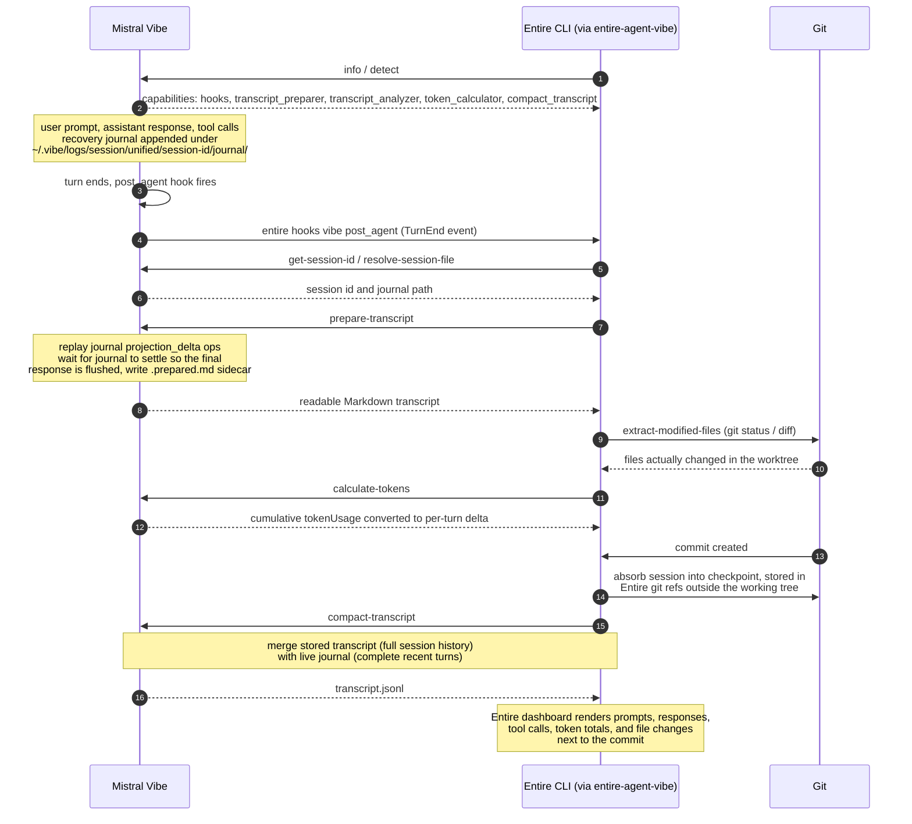

# Sequence diagram: Mistral Vibe, Entire, and Git

Main players and the activities between them during a Vibe session that is
captured as an Entire checkpoint. The `entire-agent-vibe` binary is the
bridge Entire invokes; it reads Vibe's local journal and talks to Git to
confirm file changes.

## Reading the flow

1. **Discovery** — Entire finds `entire-agent-vibe` on the `PATH` and asks
   `info` which Agent Integration Protocol capabilities it supports.
2. **Turn end** — Vibe's `post_agent` hook notifies Entire, then Entire pulls
   the session id, the prepared transcript, the Git-confirmed file changes,
   and the per-turn token delta from Vibe.
3. **Checkpoint** — when you commit, Entire stores the checkpoint in its own
   git refs (the working tree is untouched), then runs `compact-transcript`
   so the dashboard gets the merged `transcript.jsonl`.

The two safeguards that make the last response of a turn always appear are
the journal-settling wait in `prepare-transcript` and the two-source merge in
`compact-transcript` (stored transcript for full history, live journal for
the complete recent turns).

## Glossary — terms used in the diagram

Short explanations of the terms that appear above. See the **Glossary** section
in [README.md](README.md) for the full list.

| Term | Meaning |
|---|---|
| Turn | One user prompt plus the agent's full response (reasoning, tool calls, final answer). Ends when the `post_agent` hook fires. |
| Recovery journal | Vibe's JSONL log of the session under `~/.vibe/logs/session/unified/<session-id>/journal/`. It is a rolling window — older chunks are compacted away — so it always holds the recent tail, never necessarily the whole history. |
| `post_agent` hook | Vibe hook declared in `.vibe/hooks.toml`, fired at turn end. Receives a JSON payload on stdin; here it is bridged to Entire's TurnEnd lifecycle event. |
| `prepare-transcript` | Subcommand that waits for the journal to settle (quiescence), replays its projection deltas, and writes the readable Markdown transcript as a `.prepared.md` sidecar. |
| Projection delta | Journal ops (`append_entry` / `replace_entry` / `remove_entry`) that rebuild the canonical conversation state when replayed in order. |
| `extract-modified-files` | Subcommand that reports only files Git confirms as changed (`git status --porcelain`), avoiding false positives from files the agent merely read. |
| `calculate-tokens` | Subcommand that converts Vibe's cumulative `tokenUsage` into a per-turn delta. |
| Checkpoint | Entire's snapshot of the session attached to a commit, stored in Entire's git refs outside the working tree. |
| `compact-transcript` / `transcript.jsonl` | Subcommand that merges the stored transcript (full history) with the live journal (complete recent turns) into Entire's compact JSONL format, one message per line, which the dashboard renders. |
| Working tree vs. git refs | The working tree is your checked-out files; git refs live in `.git`. Checkpoint data is stored in refs, so it never shows up as uncommitted changes and is unaffected by `.gitignore`. |
